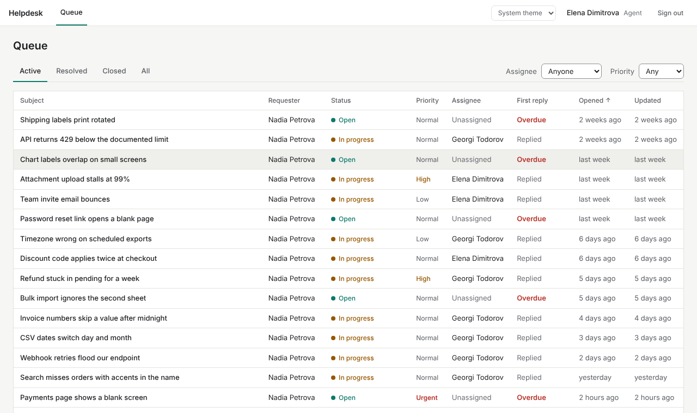
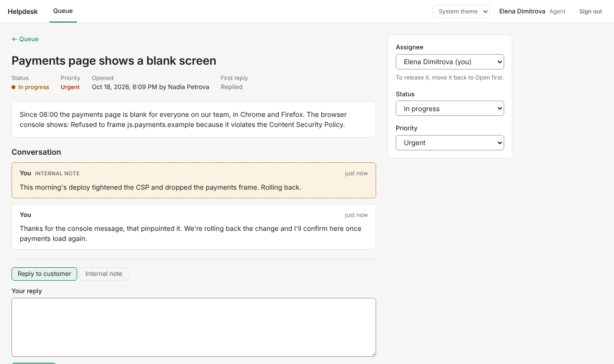
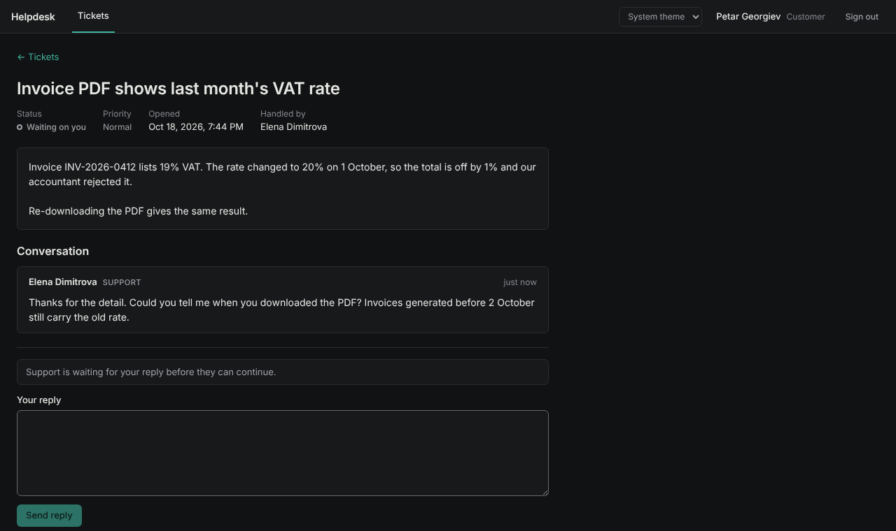
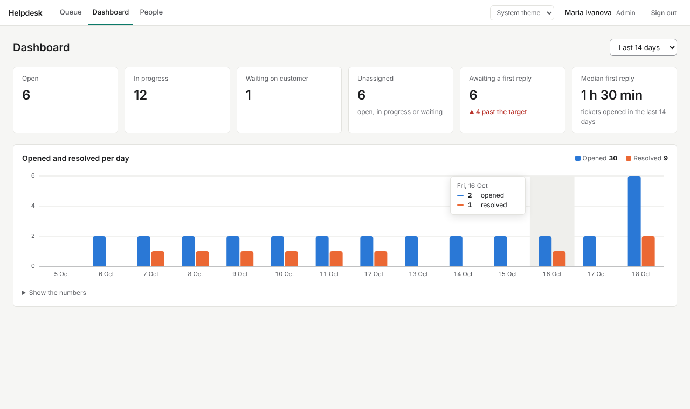

# helpdesk-platform

A ticketing tool for a small support team. Customers open tickets and follow the conversation,
agents work a shared queue with first-reply deadlines, and admins manage people and watch the
numbers. A FastAPI backend with a background worker, and a React frontend.

[](https://github.com/emilbogdanov/helpdesk-platform/actions/workflows/backend.yml)
[](https://github.com/emilbogdanov/helpdesk-platform/actions/workflows/frontend.yml)
[](https://github.com/emilbogdanov/helpdesk-platform/actions/workflows/stack.yml)


[](LICENSE)



## Features

**Customers** sign up, open tickets with a priority, and follow each one as a conversation.
The page tells them when support is waiting on them; replying moves the ticket back into
the queue, and reopens it if it had been resolved.

**Agents** work a queue they can filter by assignee and priority, oldest first, with each
ticket's first-reply deadline (urgent 1 h, high 4 h, normal 1 day, low 3 days) and `j`/`k` to
move through it. On a ticket they take it or hand it to a colleague, move it through
`open → in progress → waiting on customer → resolved → closed`, and write either a public reply
or an internal note the customer never sees.

**Admins** add people, change roles and deactivate accounts (which signs them out at once), and
have a dashboard with the queue's state, the median first-reply time and a per-day chart of
opened and resolved tickets.

Underneath:

- The ticket enforces its own lifecycle; the UI only offers the moves the server accepts.
- A worker flags tickets that missed their first-reply target and closes tickets that have
  stayed resolved for a week. Several replicas can run; a Redis lease gives each pass to one.
- An audit entry for every change, with who made it (or the worker) and the before and after.
- `Idempotency-Key` on ticket creation: a customer who presses Submit again after a dropped
  connection gets the same ticket, not a second one.
- Optimistic locking: two agents changing the same ticket at once get a clear conflict, not a
  silent overwrite.
- Cursor pagination for tickets and accounts, backed by matching indexes.
- One error shape, `{"detail", "code"}`, with a stable `code` the frontend branches on.
- Light and dark themes from one set of design tokens; keyboard and screen reader friendly.

## Tech stack

**Backend:** Python 3.13, FastAPI, SQLAlchemy 2 (async) on asyncpg, PostgreSQL 17, Alembic,
Redis 7, PyJWT, argon2-cffi, pydantic-settings.
**Frontend:** React 19, TypeScript (strict), Vite, TanStack Query, React Router, openapi-fetch
with types generated from the API's OpenAPI schema, CSS modules.
**Tooling:** uv, ruff, mypy (strict), pytest with testcontainers, ESLint (type-checked),
Prettier, Vitest with Testing Library and MSW, Playwright, pre-commit, GitHub Actions, Docker
Compose, nginx.

## Quickstart

Needs Docker and Python. The middle command writes a random signing secret to `.env`; it works
in bash and in Windows cmd (use `python3` if that is what your system calls it).

```sh
git clone https://github.com/emilbogdanov/helpdesk-platform.git && cd helpdesk-platform
python -c "import secrets; print('HELPDESK_JWT_SECRET=' + secrets.token_urlsafe(48))" > .env
docker compose up --build
```

Compose starts Postgres and Redis, runs the migrations once, then starts the API, the worker
and the web front. Open <http://localhost:8080>. The API is also published on its own at
<http://localhost:8000>, with interactive docs at <http://localhost:8000/docs>.

Anyone can sign up as a customer. Staff accounts are made by an admin, and the first admin
comes from the CLI (it prompts for the password):

```console
$ docker compose exec api helpdesk create-admin --email maria.ivanova@northwind.test --name "Maria Ivanova"
Password:
Repeat it:
created admin maria.ivanova@northwind.test (46b7e92c-7b05-45cb-b220-4db231fb8324)
```

Then sign in at <http://localhost:8080> and add your agents under People.

## Usage

### In the browser

An agent working the urgent ticket from the queue above: taken, moved to In progress, an
internal note for the team and a reply to the customer, after which the first-reply deadline
shows as met.



The customer's side of another ticket, in the dark theme. Internal notes never reach this
page, and the prompt above the reply box changes with the ticket's state.



The admin dashboard, hovering one day of the chart. The same numbers are in a table under
"Show the numbers" for screen readers and anyone who would rather read figures.



### Over the API

Everything the frontend does goes through the same API. The examples use curl and jq, and a
small helper that logs in and prints the access token:

```sh
token() {
  curl -s localhost:8000/auth/token -H 'Content-Type: application/json' \
    -d "{\"email\": \"$1\", \"password\": \"$2\"}" | jq -r .access_token
}
ADMIN=$(token maria.ivanova@northwind.test 'correct-horse-battery')
```

#### Accounts

Anyone can sign up, and always gets the customer role:

```console
$ curl -s localhost:8000/auth/sign-up -H 'Content-Type: application/json' \
    -d '{"email": "petar.georgiev@acme.test", "display_name": "Petar Georgiev", "password": "winter-orchard-42"}' | jq
{
  "id": "910d416c-47ec-4903-b405-b0a88def47cc",
  "email": "petar.georgiev@acme.test",
  "display_name": "Petar Georgiev",
  "role": "customer",
  "is_active": true,
  "created_at": "2026-10-18T14:16:32.089101Z"
}
```

Staff accounts are created by an admin:

```console
$ curl -s localhost:8000/users -H 'Content-Type: application/json' -H "Authorization: Bearer $ADMIN" \
    -d '{"email": "elena.dimitrova@northwind.test", "display_name": "Elena Dimitrova", "role": "agent", "password": "quiet-harbour-17"}' | jq
{
  "id": "eaaeee17-af3c-4a5b-aa7c-fb571b282210",
  "email": "elena.dimitrova@northwind.test",
  "display_name": "Elena Dimitrova",
  "role": "agent",
  "is_active": true,
  "created_at": "2026-10-18T14:16:32.350141Z"
}
$ CUSTOMER=$(token petar.georgiev@acme.test winter-orchard-42)
$ AGENT=$(token elena.dimitrova@northwind.test quiet-harbour-17)
```

#### Opening a ticket

```console
$ curl -s localhost:8000/tickets -H 'Content-Type: application/json' -H "Authorization: Bearer $CUSTOMER" \
    -H 'Idempotency-Key: 3b0f6c1e-0d6a-4a52-9f0e-checkout' \
    -d '{"subject": "Checkout returns 500 when the cart has a gift card", "description": "Every order with a gift card fails at the payment step since this morning. Orders without one go through.", "priority": "high"}' | jq
{
  "id": "5013d606-fa10-4d29-9850-c388206e56b8",
  "requester": {
    "id": "910d416c-47ec-4903-b405-b0a88def47cc",
    "display_name": "Petar Georgiev",
    "role": "customer"
  },
  "subject": "Checkout returns 500 when the cart has a gift card",
  "description": "Every order with a gift card fails at the payment step since this morning. Orders without one go through.",
  "priority": "high",
  "status": "open",
  "assignee": null,
  "created_at": "2026-10-18T14:16:32.634067Z",
  "updated_at": "2026-10-18T14:16:32.634067Z",
  "resolved_at": null,
  "closed_at": null,
  "first_responded_at": null,
  "sla_breached_at": null
}
```

Sending the same request again with the same key returns the ticket from the first attempt
(same `id`, same `created_at`). Reusing the key for a different ticket is rejected:

```json
{"detail": "idempotency key '3b0f6c1e-0d6a-4a52-9f0e-checkout' was already used for a different ticket", "code": "idempotency_key_reused"}
```

#### Working it

```console
$ TICKET=5013d606-fa10-4d29-9850-c388206e56b8
$ curl -s -X POST localhost:8000/tickets/$TICKET/take -H "Authorization: Bearer $AGENT" | jq -c '{status, assignee: .assignee.display_name}'
{"status":"open","assignee":"Elena Dimitrova"}
$ curl -s -X PUT localhost:8000/tickets/$TICKET/status -H 'Content-Type: application/json' -H "Authorization: Bearer $AGENT" \
    -d '{"status": "in_progress"}' | jq -c '{status}'
{"status":"in_progress"}
$ curl -s localhost:8000/tickets/$TICKET/comments -H 'Content-Type: application/json' -H "Authorization: Bearer $AGENT" \
    -d '{"body": "Payment service logs show a null currency on gift card lines. Asked the payments team.", "visibility": "internal"}' > /dev/null
$ curl -s localhost:8000/tickets/$TICKET/comments -H 'Content-Type: application/json' -H "Authorization: Bearer $AGENT" \
    -d '{"body": "We can reproduce this and a fix is going out today. We will update this ticket when it is live."}' > /dev/null
```

The customer sees the public reply only, and the reply counts as the first response:

```console
$ curl -s localhost:8000/tickets/$TICKET/comments -H "Authorization: Bearer $CUSTOMER" | jq -c '.[] | {author: .author.display_name, visibility, body}'
{"author":"Elena Dimitrova","visibility":"public","body":"We can reproduce this and a fix is going out today. We will update this ticket when it is live."}
$ curl -s localhost:8000/tickets/$TICKET -H "Authorization: Bearer $CUSTOMER" | jq -c '{status, first_responded_at}'
{"status":"in_progress","first_responded_at":"2026-10-18T14:16:32.722955Z"}
```

Rules are enforced on the server, and each refusal has its own code:

```json
{"detail": "cannot move a ticket from in_progress to closed", "code": "invalid_status_transition"}
{"detail": "only agents and admins can take tickets", "code": "staff_only"}
{"detail": "only agents and admins can write internal notes", "code": "internal_note_not_allowed"}
```

A customer asking for someone else's ticket gets `404 ticket_not_found`, the same as for a
ticket that doesn't exist.

#### The queue

Unassigned open tickets, oldest first, two per page:

```console
$ curl -s "localhost:8000/tickets?status=open&assignee=unassigned&sort=oldest&limit=2" \
    -H "Authorization: Bearer $AGENT" | jq '{items: [.items[] | {subject, priority}], next_cursor}'
{
  "items": [
    {
      "subject": "Invoice PDF shows last month's VAT rate",
      "priority": "normal"
    },
    {
      "subject": "Can't change the billing email on my account",
      "priority": "normal"
    }
  ],
  "next_cursor": "eyJzb3J0Ijoib2xkZXN0IiwiYXQiOiIyMDI2LTEwLTE4VDE0OjE2OjMyLjgyMTYwMSswMDowMCIsImlkIjoiY2VlOTM4ZWYtM2Y0MS00MDYwLTk3ZmItNjhlZGNiMDI5OWJhIn0"
}
```

Pass `next_cursor` back as `cursor` with the same filters to get the next page; it is `null`
on the last one. `status` and `priority` can be repeated (`?status=open&status=in_progress`).

#### The worker

Every `HELPDESK_WORKER_INTERVAL_SECONDS` the worker runs two passes. Here an urgent ticket had
gone two hours without a reply, and the ticket above had been resolved for eight days:

```text
2026-10-18 14:16:41,285 INFO helpdesk.worker worker started; a pass every 0:01:00
2026-10-18 14:16:41,315 INFO helpdesk.worker job flag-overdue-first-responses: 1 ticket(s) changed
2026-10-18 14:16:41,323 INFO helpdesk.worker job close-resolved-tickets: 1 ticket(s) changed
```

Several worker replicas can run at once; a Redis lease lets only one of them run each pass.

#### Audit trail

```console
$ docker compose exec db psql -U helpdesk -c "
    select coalesce(u.display_name, '(worker)') as actor, a.event_type,
           a.payload ->> 'previous' as previous, a.payload ->> 'current' as current
    from audit_entries a left join users u on u.id = a.actor_id
    where a.ticket_id = '$TICKET' order by a.id"
      actor      |    event_type    |  previous   |               current
-----------------+------------------+-------------+--------------------------------------
 Petar Georgiev  | ticket_opened    |             |
 Elena Dimitrova | assignee_changed |             | eaaeee17-af3c-4a5b-aa7c-fb571b282210
 Elena Dimitrova | status_changed   | open        | in_progress
 Elena Dimitrova | comment_added    |             |
 Elena Dimitrova | comment_added    |             |
 Elena Dimitrova | status_changed   | in_progress | resolved
 (worker)        | status_changed   | resolved    | closed
(7 rows)
```

#### CLI

```console
$ docker compose exec api helpdesk --help
usage: helpdesk [-h] {create-admin,reset-password,worker,openapi} ...
```

`create-admin` and `reset-password` prompt for the password twice, or read it from
`HELPDESK_PASSWORD` when it is set (for scripts and CI). `openapi` prints the API schema the
frontend's types are generated from.

## Project structure

```text
.
├── docker-compose.yml          db, redis, a one-shot migrate step, api, worker, web
├── .env.example                the one setting compose needs
├── docs/screenshots/           the images in this README
├── backend/
│   ├── Dockerfile              multi-stage, runs as a non-root user
│   ├── pyproject.toml          dependencies and ruff, mypy, pytest config
│   ├── migrations/             Alembic revisions
│   ├── src/helpdesk/
│   │   ├── domain/             Ticket, Comment and User with their rules; no I/O
│   │   ├── application/        use cases, and the ports they need (repositories, unit of
│   │   │                       work, hasher, token codec, audit log)
│   │   ├── infrastructure/     SQLAlchemy tables and repositories, argon2, JWT, Redis lease
│   │   ├── api/                FastAPI routes, request/response models, error mapping
│   │   ├── worker.py           the polling loop and its lease
│   │   ├── cli.py              the helpdesk command
│   │   └── main.py             composition root: builds the API and the worker from settings
│   └── tests/
│       ├── unit/               domain and services against in-memory fakes
│       ├── api/                HTTP behaviour, auth and permissions
│       └── integration/        real Postgres and Redis via testcontainers
└── frontend/
    ├── Dockerfile, nginx.conf  static build served by unprivileged nginx, /api proxied
    ├── openapi.json            the API schema, regenerated with `npm run api:generate`
    ├── e2e/                    the Playwright test that runs against the whole stack
    └── src/
        ├── api/                typed client generated from the schema, error type
        ├── app/                routes, providers, query client
        ├── features/           auth, tickets, admin, account, theme: pages, hooks, logic
        ├── layout/             the signed-in shell
        ├── ui/                 buttons, fields, notices, page states
        ├── styles/             design tokens and base styles
        └── test/               the fake backend the component tests run against
```

Dependencies point inward on the backend: `domain` imports nothing from the other layers, and
`application` knows only the ports it defines. On the frontend, components render and hooks
hold the logic; nothing outside `api/` knows about HTTP.

## Configuration

All settings are environment variables with the `HELPDESK_` prefix. Outside Docker they are
also read from `backend/.env` (see `backend/.env.example`).

| Variable | Default | Description |
| --- | --- | --- |
| `HELPDESK_DATABASE_URL` | required | `postgresql+asyncpg://` URL. Compose sets it. |
| `HELPDESK_REDIS_URL` | required | Redis URL for the worker lease. Compose sets it. |
| `HELPDESK_JWT_SECRET` | required | Signs access tokens; at least 32 characters. |
| `HELPDESK_ACCESS_TOKEN_TTL_MINUTES` | `15` | Lifetime of an access token. |
| `HELPDESK_WORKER_INTERVAL_SECONDS` | `60` | Time between worker passes. |
| `HELPDESK_AUTO_CLOSE_AFTER_DAYS` | `7` | How long a ticket stays resolved before it is closed. |
| `HELPDESK_LOG_LEVEL` | `INFO` | `DEBUG`, `INFO`, `WARNING` or `ERROR`. |
| `HELPDESK_PASSWORD` | unset | Read by `create-admin` and `reset-password` instead of prompting. |

The frontend has no runtime settings: it always calls `/api` on its own origin, which nginx
(in Docker) or Vite (in development) forwards to the API. Two variables matter for
development and testing:

| Variable | Default | Description |
| --- | --- | --- |
| `HELPDESK_API_URL` | `http://localhost:8000` | Where `npm run dev` forwards `/api`. |
| `E2E_BASE_URL` | `http://localhost:8080` | The running stack the Playwright test drives. |
| `E2E_ADMIN_EMAIL`, `E2E_ADMIN_PASSWORD` | unset | An admin the test uses to create its agent. |

## Running tests

Backend, from `backend/`:

```sh
uv sync
uv run pytest
uv run ruff check && uv run ruff format --check && uv run mypy
```

The integration tests start throwaway Postgres and Redis containers, so Docker must be
running. To skip them, run `uv run pytest -m "not integration"`. To reuse servers you already
have, set `HELPDESK_TEST_DATABASE_URL` and `HELPDESK_TEST_REDIS_URL`; the tests drop the
schema and flush Redis, so never point them at data you want to keep.

Frontend, from `frontend/`:

```sh
npm ci
npm test
npm run lint && npm run format:check && npm run typecheck
```

The component tests render the whole app, routes included, against a fake backend built on
MSW that answers with the real status and error codes. They need no server.

End to end, with the stack from the quickstart running and an admin created:

```sh
cd frontend
npx playwright install chromium
E2E_ADMIN_EMAIL=maria.ivanova@northwind.test E2E_ADMIN_PASSWORD=... npm run test:e2e
```

The test signs up a customer, opens a ticket, has a fresh agent take it, write a note and
reply, and checks the customer sees the reply but not the note. CI runs it on every push
against the stack built from that commit.

To work on the code with live reload: `docker compose up -d db redis`, copy
`backend/.env.example` to `backend/.env`, then in `backend/` run `uv run alembic upgrade head`
and `uv run uvicorn --factory helpdesk.main:app --reload`, and in `frontend/` run
`npm run dev` and open <http://localhost:5173>.

## Design notes

- **The ticket owns its rules.** Status transitions, "in progress needs an assignee", first
  response and reopen-on-reply all live on `Ticket`, which raises domain errors and records
  events. Services load, call one method and commit; the events become audit entries in the
  same transaction, so the trail can't drift from the data.
- **Concurrent writes fail loudly.** Tickets carry a version column, and a stale update is
  turned into `409 concurrent_update`, which the UI explains before reloading the ticket.
  Idempotent creates rely on a unique `(requester_id, idempotency_key)` constraint with
  `ON CONFLICT DO NOTHING` and a re-read, so two retries racing each other still make one
  ticket; the new-ticket form keeps one key for its whole life for exactly that case.
- **Keyset pagination, backed by indexes.** Cursors encode the sort value and id, and queries
  compare them as a row value, so pages stay fast and stable while rows arrive. Each ticket list
  view has a matching index, and integration tests run `EXPLAIN` to check they are used.
- **One contract, checked in CI.** The frontend's types are generated from the backend's
  OpenAPI schema and committed; CI regenerates them and fails if they differ, so an API change
  can't silently break the UI. Errors carry a stable `code` from one table in `api/errors.py`,
  and the frontend's wording is keyed on those codes, never on messages.
- **Each layer tested where it is cheapest to be sure.** Domain and service tests run against
  in-memory fakes, and the same scenarios run again on Postgres so the SQL and the fakes can't
  disagree. Frontend tests drive the full app against a fake backend. One Playwright test
  covers the path through every layer, in the built images.

## Limitations and roadmap

- First-response targets count wall-clock time; there are no business hours or holidays.
- No refresh tokens: the session lasts as long as the access token (15 minutes by default),
  then the app asks you to sign in again. Tokens aren't revoked on a password reset, though a
  deactivated account is locked out immediately.
- Password reset is admin-only through the CLI; there is no email flow, and no notifications
  of any kind yet.
- No live updates: lists refresh when you come back to the tab or act, not when a colleague
  does. Server-sent events would be the next step.
- No attachments or full-text search, and account search is a substring match without an
  index. The audit log is written but not yet shown in the UI.
- The interface is English only.

## License

MIT. See [LICENSE](LICENSE).
